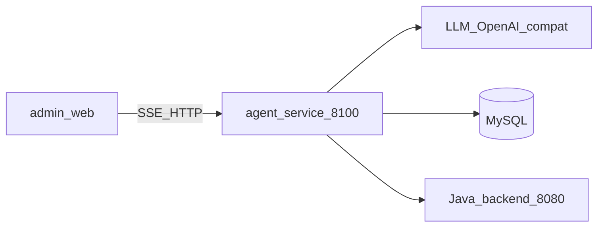
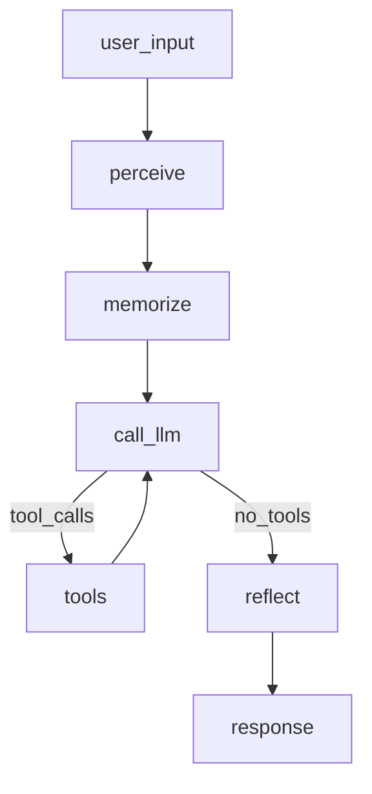

# 苍穹外卖 · 商家智能助手 Agent 服务

面向**外卖店铺商家（运营者）**的对话式经营助手：查营业额/订单/用户、管菜品与套餐、接单拒单停售，并做身份与能力边界约束。

| 项 | 说明 |
|----|------|
| 本服务 | FastAPI + LangGraph，默认端口 **8100** |
| 管理端 | Vue 2 + Element UI（`admin-web`，SSE 对接本服务） |
| 业务后端 | Spring Boot，默认 **8080**（写操作经 JWT 调 Java API） |
| 业务库 | MySQL `sky_take_out` |
| 当前版本 | **0.2.0**（七阶段主线 + 精进迭代已完成） |

接口文档：http://localhost:8100/docs  
深度上下文（给 AI / 细读）：[CONTEXT.md](CONTEXT.md)

---

## 1. 技术栈

| 层级 | 选型 | 作用 |
|------|------|------|
| Web | FastAPI + Uvicorn | HTTP / SSE、CORS、生命周期 |
| Agent 编排 | LangGraph | 有向图：感知 → 记忆 → LLM ⇄ 工具 → 反思 |
| LLM 接入 | langchain-openai（`ChatOpenAI`） | OpenAI 兼容协议；`.env` 可切通义 / 智谱 / DeepSeek 等 |
| 配置 | Pydantic Settings + `.env` | 密钥、模型、库、Java 地址 |
| 数据库 | aiomysql | 异步查询经营与菜品数据 |
| RAG | chromadb + 关键词规则 | 长期知识；embedding 当前对接 DashScope `text-embedding-v3` |
| HTTP 客户端 | httpx | 调用 Java 接单/拒单/启停售等 |
| 前端（外部） | Vue 2 + Element UI | 对话页、会话侧栏、流式渲染 |

依赖清单见 [requirements.txt](requirements.txt)。

---

## 2. 系统架构

### 2.1 外围协作



### 2.2 Agent 内部执行图



一次问答要点：

1. **感知**：清洗输入、轻量意图预分类  
2. **记忆**：会话历史 +（必要时）RAG  
3. **规划**：`bind_tools` 后调用 LLM；有 `tool_calls` 则进工具节点，否则进反思  
4. **工具**：查库或调 Java；结果写回 `messages` 再回 LLM  
5. **反思**：身份替换、边界拦截后再回前端  

状态结构（`AgentState`）：`messages`（`add_messages` 追加）、`user_input`、`session_id`、`token_usage`。

---

## 3. 实现框架（七大模块）

| 模块 | 关键路径 | 职责 |
|------|----------|------|
| 通信 | `main.py`、`api/routes.py` | 服务入口、健康检查、chat / chat/stream、会话列表与删除 |
| 感知 | `agent/perception.py` | 输入清洗、意图预分类（问候/查询/操作/边界等） |
| 记忆 | `agent/memory.py`、`agent/session.py`、`agent/knowledge/` | 工作记忆（JSON 会话）+ RAG 混合检索 |
| 规划 | `agent/graph.py`、`agent/nodes.py`、`agent/prompts.py`、`agent/service.py` | LangGraph 建图、节点、System Prompt、对外 chat API |
| 工具 | `agent/tools/`（**13** 个） | 查询/分析/写操作；`ToolNode` 执行，`bind_tools` 告知模型 |
| 反思 | `agent/reflection.py` | 输出后置校验 |
| 日志 | `agent/logging_config.py` | 控制台 + `logs/agent.log` |

### 3.1 工具一览（13）

| 类型 | 工具 |
|------|------|
| 查询 | `query_turnover`、`query_order_count`、`query_user_stats`、`query_dish_list`、`query_dish_by_name`、`query_setmeal_list`、`query_setmeal_by_name` |
| 分析 | `query_trend_analysis`、`query_top_dishes` |
| 操作（Java） | `accept_order`、`reject_order`、`stop_dish`、`start_dish` |

### 3.2 RAG 知识数据

规则与文案维护在 `agent/knowledge/data/*.json`（节假日、菜品别名、边界、身份、FAQ 等）；检索为关键词优先，必要时向量补充。

---

## 4. 当前完成度（汇报摘要）

| 阶段 | 状态 |
|------|------|
| 1–5 核心：FastAPI、LLM+SSE、MySQL Tool、Java 写操作、多轮会话 | 已完成 |
| 6 管理端对话 UI（流式 / Markdown / Tool 状态） | 已完成 |
| 7 评测集与自动化测试（文档记载约 **96%** 通过） | 已完成 |
| 架构拆分七大模块 + RAG + 会话落盘 | 已完成 |
| v0.2.0：感知落地、套餐/趋势等 Tool、Token 监控、异常与连接池增强等 | 已完成 |

**能力范围**：经营数据问答、菜品/套餐查询、订单与启停售操作、FAQ 与能力边界说明。  
**非目标**：平台超管能力、消费者端点餐助手。

---

## 5. 快速启动

```bash
# 1. 环境变量
cp .env.example .env   # 填入 LLM_API_KEY、数据库、Java 账号等

# 2. 建议使用项目 venv（勿混用 Anaconda 全局 pip）
python -m venv venv
# Windows: .\venv\Scripts\Activate.ps1
pip install -r requirements.txt

# 3. 启动（需 MySQL；写操作还需 Java 8080）
python main.py
```

`.env` 关键项：`LLM_API_KEY`、`LLM_BASE_URL`、`LLM_MODEL`（改完需**重启**服务）。  
Cursor / VS Code 解释器请选：`venv\Scripts\python.exe`。

---

## 6. 目录说明

| 路径 | 作用 |
|------|------|
| `main.py` | 服务入口（v0.2.0） |
| `config.py` | 配置中心（默认值 + 读 `.env`） |
| `api/` | HTTP 路由 |
| `agent/` | Agent 核心（图 / 节点 / 记忆 / 工具 / 知识库） |
| `db/` | MySQL 异步连接池 |
| `schemas/` | 请求响应模型 |
| `scripts/` | 评测、造数、导出图、`trace_state` 等 |
| `tests/` | 冒烟测试说明 |
| `eval/` | 评测题集与结果 |
| `learning/` | LangGraph 自学草稿（不参与运行） |
| `docs/` | 流程与回顾文档 |
| `data/sessions/` | 运行时会话（gitignore） |
| `logs/` | 运行时日志（gitignore） |

---

## 7. 修 Bug 时先看哪

- 接口 / SSE：`api/routes.py`
- 流式或落盘：`agent/service.py`、`agent/session.py`
- 图节点逻辑：`agent/nodes.py`、`agent/graph.py`
- 知识命中：`agent/knowledge/data/*.json`
- 工具 SQL / Java：`agent/tools/`

---

## 8. 常用命令

```bash
python scripts/run_test.py              # 自动化评测（需先启动服务）
python scripts/run_test.py --mode single
python scripts/run_test.py --ids A01,E02,M01
python scripts/export_graph.py          # 导出流程图到 docs/
python scripts/trace_state.py "今天营业额多少？"   # 逐步打印每步 state
```

题集：`eval/test_cases.json`；结果：`eval/results/test_*.json`。

---

## 9. 接下来该怎么做

主线已转到「与 Dify 拉开差距」的底层加固，**完整阶段、验收与检查清单**见：

**[docs/BOTTOM_UP_ROADMAP.md](docs/BOTTOM_UP_ROADMAP.md)**（P0 环境读通 → P1 评测 → P2 可信写操作 → P3 合规反思 → P4 可观测/配置解耦 → P5 经营报告 Tool）

立刻可做的最小启动（P0）：

1. 使用项目 `venv`，解释器指向 `venv\Scripts\python.exe`  
2. 配齐 `.env` 后重启 `python main.py`  
3. `python scripts/trace_state.py "你好"` 与 `"今天营业额多少？"`  

个人勾选与笔记：[LEARNING_PROGRESS.md](LEARNING_PROGRESS.md)。本周期不做 MCP / 类 Dify 编排器。

---

## 10. 相关文档

| 文档 | 用途 |
|------|------|
| [CONTEXT.md](CONTEXT.md) | 完整项目上下文、阶段史、细节约定 |
| [docs/BOTTOM_UP_ROADMAP.md](docs/BOTTOM_UP_ROADMAP.md) | 与 Dify 拉开差距的 P0～P5 路线图 |
| [docs/AGENT_EXECUTION_FLOW.md](docs/AGENT_EXECUTION_FLOW.md) | 执行流程说明 |
| [LEARNING_PROGRESS.md](LEARNING_PROGRESS.md) | 个人学习进度清单 |
